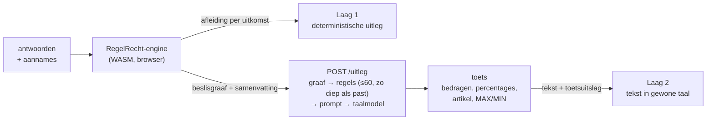

# Technische opstelling: "Waarom deze uitkomst?"

*Stand 26 november 2026. moza-portaal `main` en moza-poc-digitale-assistent `main`.*

## Opstelling

De uitleg heeft twee lagen boven één berekening.

- **Berekening.** De RegelRecht-engine (WASM, in een Web Worker in de browser) rekent per regeling met de antwoorden van de werkgever, aangevuld met aannames (`_basisfeiten.json`). Per uitkomst levert de engine een afleiding: een beslisgraaf en een korte en lange tekst.
- **Laag 1, deterministisch.** Het portaal toont de beslissende voorwaarden en de volledige afleiding, met de bron per stap. Er is geen taalmodel bij betrokken. Deze laag is leidend.
- **Laag 2, taalmodel (Graph-conditie; Bos, Schuth en Chen, JURIX 2026).** `POST /uitleg` in de digitale assistent zet de beslisgraaf om in een tekst van hoogstens 120 woorden op B1-niveau en toetst die achteraf tegen de graaf.

**Invoer van `/uitleg`:**
- de naam van de regeling;
- de beslisgraaf van de laatste uitkomst;
- de korte samenvatting van de engine.

**Uitvoer:** `{ tekst, toets, regels, mode }`; `regels` is het aantal regels dat het model kreeg. Een tekst die de toets niet haalt, gaat ook terug, met `geslaagd: false`.

## Beperkingen

1. **De toets controleert alleen getallen, het artikel en de richting van MAX en MIN.** Bij een meting met tien bewust foute zinnen miste hij er vier:
   - verwisselde getallen;
   - een omgedraaide ontkenning;
   - een getal bij het verkeerde label;
   - een verzonnen reden.
2. **De tekst is niet herhaalbaar.** Dezelfde graaf kan per aanroep een andere tekst geven.
3. **Het model ziet niet alles.**
   - Het krijgt alleen de graaf van de laatste uitkomst.
   - Een grote graaf wordt ingekort.
   - Aannames zijn niet te onderscheiden van vastgestelde feiten.
4. **De versie ontbreekt.** Het antwoord noemt niet met welke versie van het corpus en welke peildatum is gerekend.

## Verbeteringen

| Wat | Waarvoor |
|---|---|
| Elke zin citeert de knopen waarop die rust; de toets controleert per zin. | herleidbaarheid per zin (beperking 1) |
| Per citaat ook controleren: klopt waar of onwaar, en hoort het getal bij die knoop? | de fouten die de toets nu mist (beperking 1) |
| Aannames als eigen herkomst in de graaf | aanname en feit uit elkaar houden (beperking 3) |
| Corpusrevisie en peildatum in het antwoord | herleidbaarheid (beperking 4) |
| Opslaan per hash van graaf, prompt en model | herhaalbaarheid en kosten (beperking 2) |
| Vaste meetset via `uitleg-cli batch` bij elke promptwijziging | achteruitgang zien |

Valt laag 2 niet trouw genoeg te krijgen, dan is het alternatief: sjablonen in laag 1, met hoogstens een taalmodel dat zin voor zin herschrijft.
