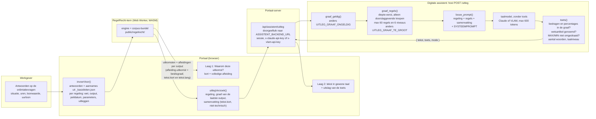

# "Waarom deze uitkomst?": technische opstelling

Stand 23 november 2026. Bronnen: moza-portaal `main` (`personeel/iemand-aannemen/_waarom.tsx`,
`_uitlegTaalmodel.tsx`, `_useRegelrecht.ts`, `api/assistent/[...pad]/route.ts`),
moza-poc-digitale-assistent `main` (`services/host/uitleg.py`, PDR-016) en draft-PR #80
(`feat/uitleg-graph-conditie`).

## Twee lagen

| Laag | Waar | Wat | Taalmodel |
|---|---|---|---|
| 1. Waarom deze uitkomst? | portaal, `_waarom.tsx` | Kort: de beslissende voorwaarden en de berekening in gewone woorden. Uitgebreid: de volledige afleiding, per stap met de bron. | nee, deterministisch uit de trace |
| 2. Leg dit uit in gewone taal | portaal `_uitlegTaalmodel.tsx` → digitale assistent `POST /uitleg` | Eén lopende tekst van hoogstens 120 woorden, op B1-niveau, met het wetsartikel aan het eind. Achteraf getoetst tegen de graaf. | ja: Claude (standaard) of VLAM |

Laag 1 is leidend. Laag 2 is een leeslaag eronder, met de vermelding dat bij twijfel de afleiding geldt (PDR-016, punt 3).

## Wat erin gaat en wat eruit komt

### Per onderdeel

| Onderdeel | Gaat erin | Komt eruit |
|---|---|---|
| `invoerVoor` (portaal) | antwoorden van de werkgever, `_basisfeiten.json` | per regeling: wet, output, peildatum, parameters, `uitleggen` |
| RegelRecht-kern (WASM, worker) | invoer per regeling | uitkomsten; per output een afleiding met `uitkomst` (de beslisgraaf) en `tekst.kort` / `tekst.lang` |
| Laag 1 (`_waarom.tsx`) | afleidingen | korte uitleg en de volledige afleiding met bron per stap |
| `uitlegVerzoek` (portaal) | afleidingen, gekozen outputs, naam regeling | `{ regeling, graaf, samenvatting }`; de graaf is die van de laatste output (meestal het bedrag) |
| Doorgeefluik `/api/assistent/[...pad]` | verzoek + sessie + sleutel in een header | hetzelfde verzoek naar de host; geen backend-adres in de browser |
| `graaf_regels` | beslisgraaf | ingesprongen regels: soort, naam, waarde, grond, herkomst |
| `bouw_prompt` + `SYSTEEMPROMPT` | regels, regeling, samenvatting | gebruikersbericht; spelregels: alleen wat in de graaf staat, B1, de werkgever aanspreken, bedragen precies overnemen, artikel noemen |
| taalmodel | systeemprompt + bericht | tekst |
| `toets` | tekst, regels, samenvatting | `geslaagd`, onbekende bedragen, onbekende percentages, `artikel_genoemd`, aantal woorden, opmerkingen |
| Laag 2 (`_uitlegTaalmodel.tsx`) | `{ tekst, toets, mode }` | de tekst, ook als de toets niet slaagt; bij een fout of als de dienst er niet is alleen een melding |

**Andere ingangen op dezelfde module:**
- **MCP-server** `services/mcp/uitleg/server.py`: tools `verwoord`, `toets` en `regels`; het model komt van de aanroeper via MCP-sampling.
- **CLI** `uitleg-cli`: `regels`, `toets`, `verzoek`, `verwoord` en `batch`; `batch` is voor metingen.

**Wat draft-PR #80 verandert:**
- Het model krijgt de afleiding tot aan de invoer, met de drempels uit de wet erbij, zoals "binnen zes maanden".
- Bedragen en percentages staan in dezelfde vorm als in de uitkomst.
- Via VLAM is de temperature lager.
- Endpoint en antwoordvorm blijven gelijk.

## Wat er nu schuurt

1. **De toets ziet maar een deel van de fouten.** Bij de meting "Is de trace genoeg?" (30 september) stonden tien bewust foute zinnen. De toets ving er zes, en miste vier:
   - verwisselde getallen;
   - een omgedraaide ontkenning;
   - een bedrag bij het verkeerde label;
   - een verzonnen reden zonder getal.

   De meting van 20 oktober vond één inhoudelijke fout die de toets niet zag: een MAX als "laagste". Op die omgedraaide rekenstap toetst hij sindsdien wel.
2. **Niet herhaalbaar.** Dezelfde graaf geeft per aanroep een andere tekst. Voor een ondernemer is dat acceptabel. Voor de motivering van een besluit niet (Awb 3:46).
3. **Alleen de graaf van de laatste output.** Meestal is dat het bedrag. De voorwaarden voor het recht staan er alleen in voor zover het bedrag ervan afhangt. Wat er verder bij de andere outputs staat, ziet het model niet; het krijgt daarvan alleen de korte samenvatting.
4. **Inkorten haalt voorwaarden weg.** Boven 60 regels of 6 niveaus valt de rest weg. #80 verruimt dat binnen de lengte van de prompt, maar de grens blijft.
5. **Aannames lijken feiten.** Wat het portaal aanneemt (uit `_basisfeiten.json`) staat in de graaf als gewone invoer. Het model kan een aanname als vaststaand feit verwoorden.
6. **Versie van de regels ontbreekt.** Het antwoord noemt niet met welke versie van het corpus en welke peildatum gerekend is. Dat kost herleidbaarheid zodra de regels veranderen.
7. **Twee teksten, twee formuleringen.** Laag 1 en laag 2 verwoorden dezelfde afleiding verschillend. Een lezer kan ze naast elkaar als tegenstrijdig lezen.
8. **Afhankelijk van de host.** Elke klik is een aanroep van een taalmodel via de digitale assistent. Dat kost tijd en geld, en zonder host is laag 2 er niet. Volgens de koers van 27 oktober hoort het rekenen bij RegelRecht. De uitleg via een taalmodel zit nu nog in de digitale assistent.

## Alternatieven en verbeteringen

| # | Voorstel | Wat het oplost | Wat het kost |
|---|---|---|---|
| A | **Citaten per zin.** Het model noemt bij elke zin de knopen waarop die rust (variant C uit "Is de trace genoeg?"). De toets controleert per zin of de getallen bij die knopen horen. | punt 1; elke zin is te herleiden. In de meting waren 73 van de 73 zinnen herleidbaar, zonder gevonden fouten. | prompt- en toetswerk; iets langere invoer |
| B | **Strengere toets.** Per geciteerde voorwaarde moet waar of onwaar in de zin terugkomen. Elk getal moet de eigen waarde zijn van de knoop die de zin noemt. | de vier gemiste soorten fouten van punt 1 | alleen zinvol samen met A |
| C | **Aannames apart.** Knopen uit `_basisfeiten.json` krijgen in de graaf de herkomst "aanname". De prompt laat die als "aangenomen" noemen, en de toets controleert dat. | punt 5 | het portaal moet de herkomst meegeven |
| D | **Versie in het antwoord.** Corpusrevisie, engineversie en peildatum gaan mee in het verzoek en terug in het antwoord. Laag 1 en laag 2 tonen ze. | punt 6 | klein |
| E | **Opslaan per graaf.** Een hash van graaf, prompt en modelversie wordt de sleutel. Dezelfde invoer geeft dan dezelfde tekst. | punt 2 in de praktijk, en punt 8 (kosten, wachttijd) | opslag; ongeldig maken bij een nieuwe prompt |
| F | **Graaf over alle outputs.** Recht én bedrag gaan mee, met een gezamenlijke inkorting. | punt 3 | langere invoer; vraagt A om trouw te blijven |
| G | **Sjabloon, geen taalmodel.** Laag 1 krijgt betere B1-sjablonen per soort knoop, met labels in de presentatielaag (variant A). Laag 2 vervalt of wordt optioneel. | punten 1, 2, 7 en 8 volledig | minder vloeiende tekst; labels per wet onderhouden |
| H | **Taalmodel herschrijft alleen.** Het sjabloon van G is het skelet. Het model herschrijft zin voor zin naar B1, en de toets vergelijkt elke zin met zijn sjabloonzin. | punten 1 en 7, met een vloeiende tekst | twee lagen onderhouden |
| I | **Uitleg naar RegelRecht.** `graaf_regels` en `toets` gaan als bibliotheek naast de engine. De aanroep van het taalmodel blijft een losse dienst. | punt 8; elke afnemer gebruikt dezelfde toets | verhuizing; afspraken met het RegelRecht-team |
| J | **Vaste meetset.** Een set grafen met verwachte en bewust foute teksten draait bij elke wijziging van de prompt, via `uitleg-cli batch`. | bewaakt alle punten; voorkomt achteruitgang | een keer opzetten |

**Advies:**
- **Eerst, klein en direct nuttig:** A + B + C + D. Die maken laag 2 per zin herleidbaar, houden aannames en feiten uit elkaar, en zetten de versie in het antwoord.
- **Daarna:** J, om te blijven meten.
- **Later:** E, voor kosten en herhaalbaarheid.
- **G of H** zijn de keuze als blijkt dat laag 2 niet trouw genoeg te krijgen is. Ook dan blijft laag 1 de basis.

## Open vragen

- Leest een werkgever laag 2 echt, of is laag 1 met betere sjablonen genoeg? Dit is de onderzoeksvraag uit PDR-016.
- Mag een tekst die afgekeurd is door de toets in een productieversie getoond worden? PDR-016 laat dat bij de afnemer. Voor de PoC: ja.
- Waar hoort de uitleg met een taalmodel thuis als het rekenen bij RegelRecht ligt: in de digitale assistent, in RegelRecht, of in het portaal zelf?
